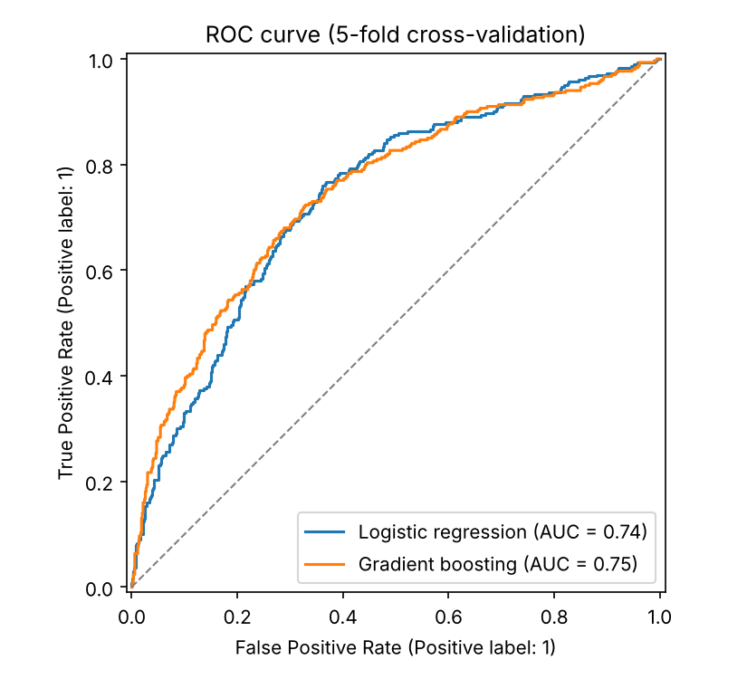
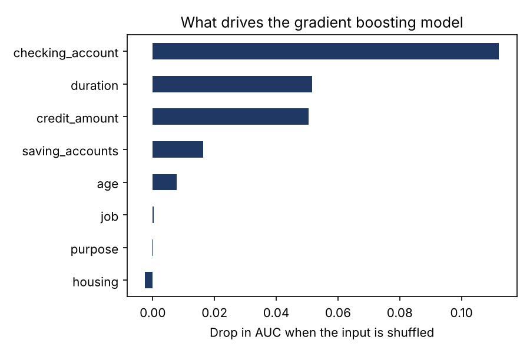

# Credit Risk Scoring with Explainable Decisions

**Status:** version 0.1, working. Next version planned for December 2026.

Can we predict which borrowers will default, decide who to refuse in a way that **minimises the bank's losses**, and **explain every decision**?

## Data
1,000 borrowers from the German Credit dataset (UCI Machine Learning Repository), 30% of whom defaulted. Inputs: loan amount, duration, purpose, savings, checking account, housing, job, age. See [`data/SOURCES.md`](data/SOURCES.md).

**Gender is deliberately excluded from the model.** A bank should not price credit on gender, and in many countries it is not allowed to. It is only used afterwards to check fairness.

## Method
1. **Two models:** logistic regression, the benchmark banks use because it is easy to explain, and gradient boosting.
2. **Honest evaluation:** 5-fold cross-validation, so every borrower is scored by a model that never saw them.
3. **Business decision, not just accuracy:** approving a borrower who then defaults is assumed to cost 5 times more than refusing a good one (the standard cost matrix for this dataset). The refusal threshold is chosen to minimise that cost.
4. **Explainability:** the main drivers of each model, and a breakdown of why one specific applicant is refused.
5. **Fairness check:** approval rates for women and men.

## Results (5-fold cross-validation)

| Model | AUC | Refuse if P(default) ≥ | Refusal rate | Defaults caught | Cost per applicant |
|---|---|---|---|---|---|
| Logistic regression | 0.740 | 0.18 | 61% | 86% | **0.56** |
| Gradient boosting | 0.748 | 0.12 | 71% | 89% | 0.60 |
| Approve everyone | | | 0% | 0% | 1.50 |



**What this shows**
- **Both models cut the expected cost by more than half** compared with approving everyone (0.56 vs 1.50 per applicant).
- **Gradient boosting has a slightly higher AUC, but the logistic regression costs the bank less** and is far easier to explain. For a bank, the logistic model is the better choice here.
- **Refusal rates are high** because a default is assumed to cost 5 times more than a lost good client. With a different cost ratio, the threshold and the refusal rate change; this is a business decision, not a statistical one.

## What drives the decisions



- **Checking account status is by far the strongest signal**, followed by loan duration and amount.
- A surprise worth investigating: applicants with **no known checking account default less** in this data. It is a reminder that a model learns patterns from its data, which are not always causal.
- **Example of an explained refusal:** the riskiest test applicant (90% estimated probability of default) is refused mainly because of a **long loan duration**, a loan for **education**, and **little savings**. Full table in [`output/results.md`](output/results.md).

## Fairness check
Even without gender as an input, approval rates are **37% for women and 40% for men**. Other inputs can act as indirect proxies. The gap is small on this sample, but it shows why a bank must monitor outcomes, not only inputs.

## Applying this in Morocco

**Why the data is German.** Borrower-level credit data from Moroccan banks is confidential, and I am not aware of any public Moroccan dataset of this kind. The German Credit data is the standard public reference for credit scoring. What this project demonstrates is the method: cost-based decisions, explanations and fairness checks. It is built to be retrained on a Moroccan bank's own portfolio.

**Why it matters in Morocco.** According to Bank Al-Maghrib's banking supervision report for 2025, as reported by Le Matin:
- non-performing loans (créances en souffrance) stood at **102.3 billion dirhams**, or **8.3% of loans** at individual bank level (8.8% for the 11 banking groups on a consolidated basis);
- they were covered by provisions at **68%**;
- the cost of risk was **9.8 billion dirhams** in 2025, down 25.1% after a 38.5% increase in 2024.

With roughly one loan in twelve not being repaid normally, a better approve or refuse decision has a direct effect on a Moroccan bank's results.

**How credit information works in Morocco.** Banks report loans and repayment behaviour to Bank Al-Maghrib, which passes the data to two approved credit bureaus, **Creditinfo Maroc** and **Quantik Maroc**. Banks must consult a credit bureau before granting a loan and receive a solvency report on the borrower. Credit bureaus are governed by **law 01-22** on credit information bureaus.

**Inputs a Moroccan version would add**
- The credit bureau solvency report and past payment incidents
- Formal or informal income, and employer sector
- Existing debt with other banks
- Regional and sector data for small business loans

**One line for interviews:** *trained on public data, built to be retrained on a Moroccan bank's own portfolio, with decisions tuned to the bank's real cost of default.*

**Sources**
- Le Matin. (2026, July 22). *Bank Al-Maghrib confirme la bonne santé du secteur bancaire en 2025*. https://lematin.ma/economie/bank-al-maghrib-confirme-la-bonne-sante-du-secteur-bancaire-en-2025/357274/amp
- Bank Al-Maghrib. (2025). *Rapport annuel sur la supervision bancaire, exercice 2025*. https://www.bkam.ma/content/download/847382/9161972/Rapport%20DSB%202025.pdf
- Bank Al-Maghrib. (n.d.). *Centralisation des risques de crédit*. https://www.bkam.ma/fr/Trouvez-l-information-concernant/Services-rendus-au-public/Service-d-interet-commun/Centralisation-des-risques-de-credit
- Royaume du Maroc. (2024). *Dahir n° 1-24-12 portant promulgation de la loi n° 01-22 relative aux bureaux d'information sur le crédit*. https://adala.justice.gov.ma/api/uploads/2025/11/19/Dahir%20n%C2%B0%201-24-12%20portant%20promulgation%20de%20la%20loi%20n%C2%B0%2001-22%20relative%20aux%20Bureaux%20d%E2%80%99information%20sur%20le%20cr%C3%A9dit1-1763563938808.pdf

## Run it
```
pip install -r requirements.txt
python -m src.run          # full analysis, writes output/
python -m pytest tests     # automated tests
```

## Repository
```
src/      data, models, cost-based evaluation, explainability, runner
output/   results table and charts
tests/    automated tests
data/     source (the CSV is created on first run)
```

## Limits and roadmap
- [x] Benchmark and improved model, cross-validated
- [x] Cost-based refusal threshold
- [x] Global and individual explanations, fairness check
- [x] Moroccan context: non-performing loans, credit bureaus, inputs to add
- [ ] Larger and more recent dataset (1,000 borrowers from Germany is small and old)
- [ ] Probability calibration and a scorecard in points, as banks use
- [ ] SHAP explanations for the gradient boosting model
- [ ] Sensitivity of the decision to the cost ratio

*Student project for learning purposes.*

© 2026 Kamar Maroihi. All rights reserved.
